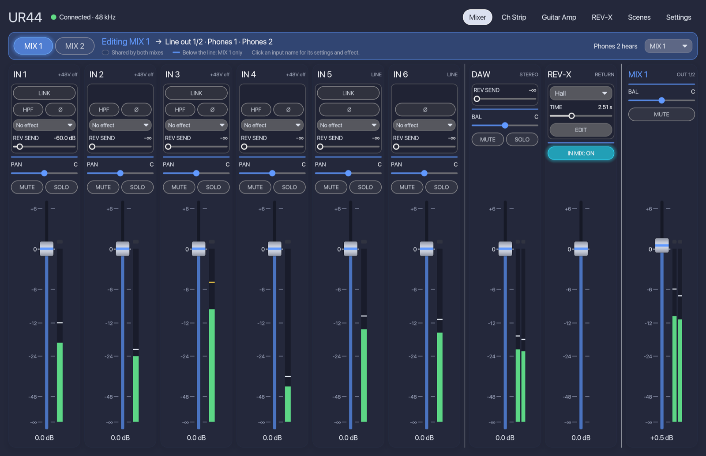
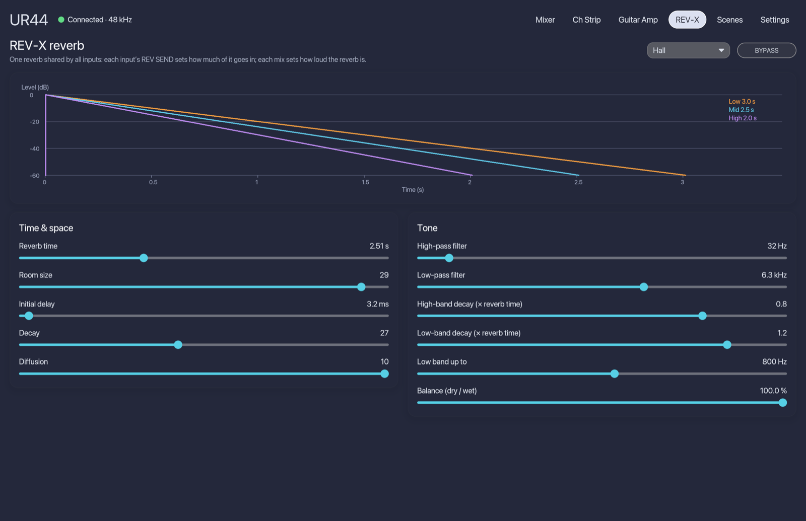
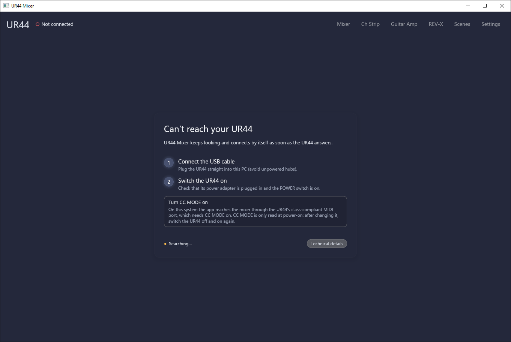

# UR44 Mixer

**An open-source replacement for dspMixFx: control the Steinberg UR44's built-in DSP mixer, channel strips, guitar amps and REV-X reverb, without the vendor's control software.**

Written in Rust. Runs on **macOS** and **Windows**. Also contains an experimental low-latency Core Audio driver for macOS (about 1.6 ms round trip).



> [!NOTE]
> This is an independent community project. It is not affiliated with, endorsed by or supported by Yamaha Corporation or Steinberg Media Technologies. "UR44", "dspMixFx", "REV-X", "Sweet Spot Morphing Channel Strip" and "Guitar Amp Classics" are trademarks of their respective owners. Use at your own risk.

## Features

| Page | What it does |
|---|---|
| **Mixer** | 6 inputs, DAW and REV-X returns, MIX 1 / MIX 2 masters. Mute, solo, pan, stereo link with fader link, HPF, phase, REV-X send, effect insert. Live level meters. |
| **Ch Strip** | The 4 channel strips: Sweet Spot presets, MORPH, drive, total gain, compressor and EQ, with curve graphs and gain-reduction meters. |
| **Guitar Amp** | Clean / Crunch / Lead / Drive amp models. |
| **REV-X** | Hall / Room / Plate with every parameter and a decay graph. |
| **Scenes** | Store, recall and delete your own mixer snapshots. |
| **Settings** | Sample rate, input 5/6 level, HPF frequency, loopback, PHONES 2 source, start at login, menu-bar/tray mode. |

UR44 Mixer runs quietly in the background like a driver's helper. It starts at login without a window, keeps the connection to the UR44 open and restores your last mixer settings when the UR44 is switched on. Closing the window leaves it running in the menu bar (macOS) or system tray (Windows).

The app follows the hardware's own rules: stereo-link mirroring, solo behaviour, channel-strip morphing, the DSP budget for inserted effects (4 units, a guitar amp takes 2) and the same value displays (dB, ms, Hz) as the UR44 itself.



## Requirements

- A Steinberg **UR44** (the original model, USB ID `0499:150e`; the UR44C is a different device).
- **macOS 13+** (Apple Silicon or Intel) or **Windows 10/11** (x64).
- [Rust](https://rustup.rs) (stable) to build from source.

### How it talks to the UR44

The UR44 has a **CC MODE** switch on the back.

- **CC mode on.** The UR44 runs as a class-compliant device on the operating system's own USB audio driver, so no vendor driver is needed. UR44 Mixer controls the DSP over the UR44's second MIDI port. On macOS this means you can stay on Full Security, with no kernel or system extensions. Switch CC MODE on *before* powering the UR44 on.
- **CC mode off** (vendor driver installed). On macOS, UR44 Mixer talks to the DSP over USB interface 4, alongside the vendor driver. On Windows, use CC mode for now (see [Windows](#windows)). A Yamaha-mode driver for Windows is being researched (see below).

## Install

### macOS

```sh
git clone https://github.com/Efllux/ur44-mixer.git
cd ur44-mixer
cargo test
./tools/bundle.sh          # builds and installs ~/Applications/UR44 Mixer.app
```

Then open **UR44 Mixer** from `~/Applications` or Spotlight.

`UR44 Mixer.app` is a small launcher (`ur44-open`) that asks the background agent (`Contents/Helpers/UR44 Mixer Agent.app`, binary `ur44-mixer`) to show its window, or starts it. The login item is `~/Library/LaunchAgents/local.ur44.mixer.agent.plist`. Data lives in `~/Library/Application Support/UR44 Mixer/`.

### Windows

Requires [Rust](https://rustup.rs) with the MSVC toolchain (Visual Studio Build Tools, C++ workload). It installs for the current user only, with no admin rights and no drivers:

```powershell
git clone https://github.com/Efllux/ur44-mixer.git
cd ur44-mixer
powershell -ExecutionPolicy Bypass -File tools\install-windows.ps1 -StartAtLogin -Launch
# uninstall: powershell -ExecutionPolicy Bypass -File tools\install-windows.ps1 -Uninstall
```

This puts `ur44-mixer.exe`, `ur44-open.exe` and `ur44ctl.exe` in `%LOCALAPPDATA%\Programs\UR44 Mixer` and adds a **UR44 Mixer** Start menu shortcut. With `-StartAtLogin` it also adds an `HKCU\…\Run` entry, which the Settings toggle controls. Settings, scenes and a log (`ur44-mixer.log`) are kept in `%APPDATA%\UR44 Mixer`.

On Windows the mixer currently connects over MIDI. Switch **CC MODE on** and power-cycle the UR44, so that Windows' built-in drivers provide the MIDI ports. Run `ur44ctl ports` to see which port it uses.



## Command-line tool

`ur44ctl` reads and writes the DSP parameters directly:

```sh
cargo run --release --bin ur44ctl -- version     # firmware / connection check
cargo run --release --bin ur44ctl -- get ChHpfOnf 0
cargo run --release --bin ur44ctl -- dump        # every parameter
cargo run --release --bin ur44ctl -- watch       # print changes made on the device or in another app
```

Other commands: `set <name> <channel> <value>`, `scan <from> <to>`, and two non-destructive hardware self-tests (`selftest-recall`, `selftest-strip`).

## How it works

| File | Role |
|---|---|
| `src/protocol.rs` | SysEx protocol on the UR44's second MIDI port (`F0 43 {10\|30} 3E 14 …`), 7-bit packed values, meter stream (44 values, `dB = v / 102.4 − 80`, calibrated with test tones). |
| `src/device.rs`, `src/usbmidi.rs` | Connection over MIDI (CC mode) or raw USB-MIDI on interface 4. |
| `src/params.rs`, `src/catalog.rs` | The 177 DSP parameters: ids, ranges, defaults, labels, verified against the hardware. |
| `src/logic.rs` | Mixer rules: link mirroring, solo, morph interpolation, effect-type defaults, DSP insert budget. |
| `src/dsp.rs` | EQ and compressor curves, meter scales and REV-X decay time for the graphs, at the UR44's current sample rate. |
| `src/scene.rs` | Scene files (JSON). |
| `src/ssd.rs` | Reads Sweet Spot presets from the vendor's installed preset files, if present (they are not redistributed). |
| `src/bin/ur44-mixer/` | The [iced](https://iced.rs) GUI and background agent. |

### Experimental macOS driver (`driver/`)

`driver/` contains a user-space Core Audio (AudioServerPlugIn) driver for the UR44 in its native (non-CC) mode. It is a port of [QuadCaptureMac](https://github.com/louistissot/quad-capture-macos-silicon-driver) (MIT). It reaches about **1.6–1.7 ms analog round trip** (48–192 kHz), compared with roughly 4.4 ms for the vendor driver and 3 ms for Apple's class driver on the same Mac. Measurements are in [`docs/latency-measurements.md`](docs/latency-measurements.md) and [`docs/driver-resources.md`](docs/driver-resources.md).

It is **experimental**: it needs `sudo` to install into `/Library/Audio/Plug-Ins/HAL`, and it isn't signed or notarized. Build with `driver/build.sh`. Background research on the approach is in [`docs/driver-landscape.md`](docs/driver-landscape.md).

### Windows driver (research)

A matching user-mode driver for Windows (WinUSB transport + ASIO) is in the research phase. The landscape, the expected latency floor and the open questions are in [`docs/driver-landscape-windows.md`](docs/driver-landscape-windows.md).

## Known gaps

- Gain-reduction meter slot verified for strip 1 only. Idle strips 3/4 report a placeholder value (shown as "–").
- The REV-X graph is a 2-D decay per band rather than a 3-D envelope.
- Guitar amp "Air" is shown as a number (0–2).
- Linux: the app builds and its tests pass in CI, but it has not been tested with a UR44 on Linux.

## Contributing

Issues and pull requests are welcome. Run `cargo test` before sending a PR; CI builds and tests on macOS, Windows and Linux. Please don't submit vendor binaries, extracted vendor files or decompiled code.

## License

[MIT](LICENSE). The driver in `driver/` is also MIT, and includes code from QuadCaptureMac © Louis Tissot and contributors (see [`driver/LICENSE`](driver/LICENSE)).
